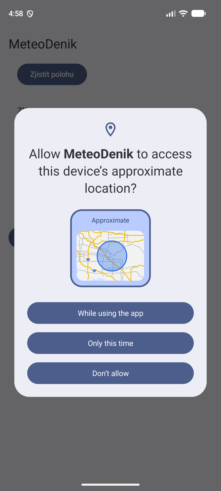
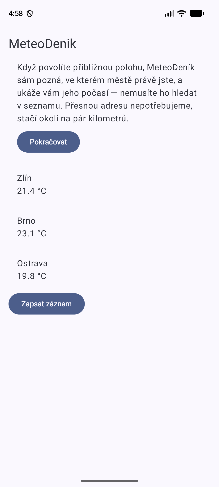
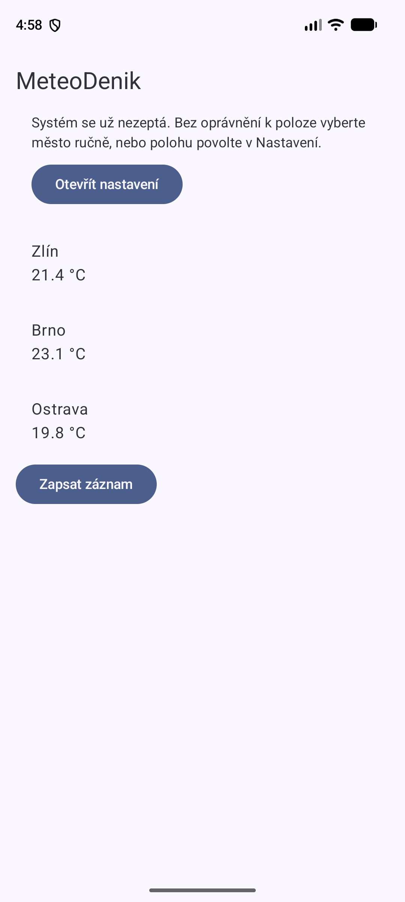
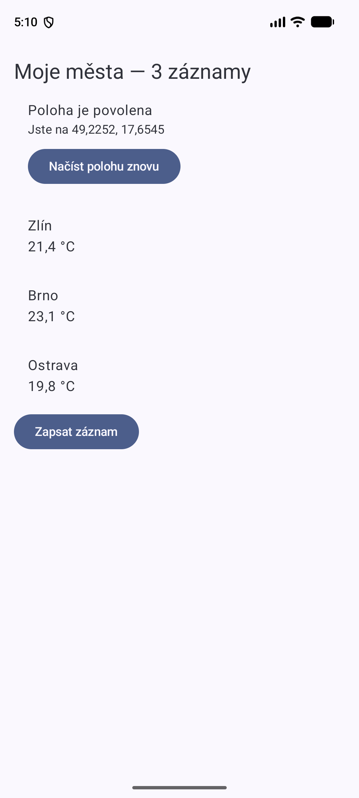

# Lekce 06 – žádost o polohu (cvičení 6.2)

Měřeno na emulátoru Pixel 8, Android 17 (API 37). Oprávnění: `ACCESS_COARSE_LOCATION`.
Mezi pokusy resetováno příkazem:

```
adb shell pm clear-permission-flags cz.utb.meteodenik android.permission.ACCESS_COARSE_LOCATION user-set user-fixed
```

## Čtyři stavy

| Stav | Co uživatel udělal | Co je na obrazovce | Příznaky v systému | Snímek |
|---|---|---|---|---|
| `NEZNAMY` | první klik na „Zjistit polohu“ | systémový dialog (While using the app / Only this time / Don't allow) | žádné | [1](lekce-06-opravneni-1-dialog.png) |
| `ODMITNUTO` | jednou „Don't allow“, pak znovu klik | moje vysvětlení a tlačítko „Pokračovat“; teprve po něm systémový dialog | `USER_SET` | [2](lekce-06-opravneni-2-vysvetleni.png) |
| `ODMITNUTO_NATRVALO` | podruhé „Don't allow“ | text „Systém se už nezeptá…“ a tlačítko „Otevřít nastavení“, žádný dialog | `USER_SET`, `USER_FIXED` | [3](lekce-06-opravneni-3-natrvalo.png) |
| `UDELENO` | „While using the app“ (nebo povolení v Nastavení a návrat Zpět) | „Poloha je povolena“ a souřadnice, případně text, že poloha zatím není známá | `granted=true` | [4](lekce-06-opravneni-4-udeleno.png) |






## Proč se trvalé zamítnutí vyhodnocuje v callbacku, a ne při startu

`shouldShowRequestPermissionRationale` vrací `false` ve dvou různých situacích: když jsme se ještě neptali, a když je oprávnění zamítnuté natrvalo. Při startu aplikace je tedy nedokážeme rozlišit. Rozdíl se pozná až po odmítnutí v dialogu: v callbacku spouštěče víme, že se uživatel právě rozhodl, a `false` tam znamená „systém se už nezeptá“.

## Proč ACCESS_COARSE_LOCATION, a ne ACCESS_FINE_LOCATION

- **Přibližná poloha** (`ACCESS_COARSE_LOCATION`) má podle dokumentace Androidu přesnost zhruba na 3 km². To na určení města, pro které chceme ukázat počasí, stačí.
- **Přesná poloha** (`ACCESS_FINE_LOCATION`) má přesnost obvykle do 50 m. Tu MeteoDeník nepotřebuje. Žádat o ni by znamenalo zbytečně zasahovat do soukromí a uživatel by spíš odmítl.
- Od Androidu 12 si uživatel může zvolit přibližnou polohu, i když aplikace žádá přesnou, takže kód s přibližnou polohou musí počítat tak jako tak.

Zdroj: Android Developers, *Request location permissions* – https://developer.android.com/develop/sensors-and-location/location/permissions

## Čtení polohy

- Poloha se čte přes `LocationManager.getLastKnownLocation(NETWORK_PROVIDER)` uvnitř `try/catch (e: SecurityException)`.
- Před každým čtením se znovu volá `checkSelfPermission`, protože uživatel mohl oprávnění mezitím odebrat.
- Když je poloha `null` (emulátor bez nastavené polohy, telefon v metru), karta ukáže text `poloha_neznama` ze `strings.xml`, ne prázdné místo.
- Emulátor nemá síťovou lokalizaci (Wi-Fi, vysílače), takže `NETWORK_PROVIDER` na něm vrací `null` i po `adb emu geo fix`. Proto je v kódu záloha `PASSIVE_PROVIDER`, tedy poslední poloha, kterou si vyžádala kterákoli aplikace (například Mapy Google).
- U přibližné polohy Android předává aplikaci novou hodnotu jen zhruba jednou za 10 minut. Po nastavení polohy emulátoru proto chvíli trvá, než karta ukáže nové souřadnice.

## Naměřeno

- Poloha emulátoru nastavená příkazem `adb emu geo fix 17.6683 49.2265` (Zlín) a jednou otevřenými Mapami Google.
- Hned po povolení karta ukázala starou výchozí polohu emulátoru (37,4054, −122,0912, Kalifornie). Po zhruba 10 minutách a stisku „Načíst polohu znovu“ ukázala **49,2252, 17,6545** (snímek 4).
- Rozdíl proti nastaveným 49,2265, 17,6683 je zhruba 1 km. To je úmyslné zkreslení přibližné polohy, které dělá systém, ne chyba v kódu.
